# SolvPred App

SolvPred App is the code-free desktop GUI for [SolvPred](https://github.com/xueannafang/hsp_toolkit_solv_pred_v_2.0).

It provides a user-friendly workflow for solvent mixture design based on Hansen solubility parameters. (Check [here](https://github.com/xueannafang/HSP_toolkit_docs/blob/main/hsp_tool_general_intro.md) for project backgrounds.)

---

## Installation

Clone this repo to your desired directory:

```bash
git clone https://github.com/xueannafang/SolvPred_App.git
```

Create the conda environment:

```bash
conda env create --file environment.yml
```

Launch the app:

```bash
python run_app.py
```

<details>
<summary>Build a standalone executable (optional)</summary>

```bash
pyinstaller --onefile --name=SolvPredApp --add-data "app/data;app/data" --add-data "app/assets;app/assets" --collect-all numpy run_app.py
```

</details>

---

## Workflow Overview

| Step | Page | Purpose |
|------|------|---------|
| 1 | Welcome | Launch the app |
| 2 | Select Solvents | Build your candidate solvent list |
| 3 | Target HSP | Set target HSP values and parameters |
| 4 | Run Calculation | Apply filters and run the solver |
| 5 | Results | View, filter, sort, and export results |

---

## Step-by-step guide

### Welcome Page

This will launch the executable file `SolvPredApp.exe`. A welcome page will appear.

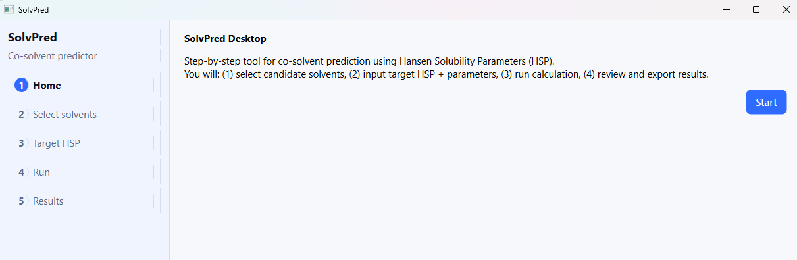

Click **Start** to proceed to the solvent candidate selection page.

---

### Step 1: Select Solvent Candidates

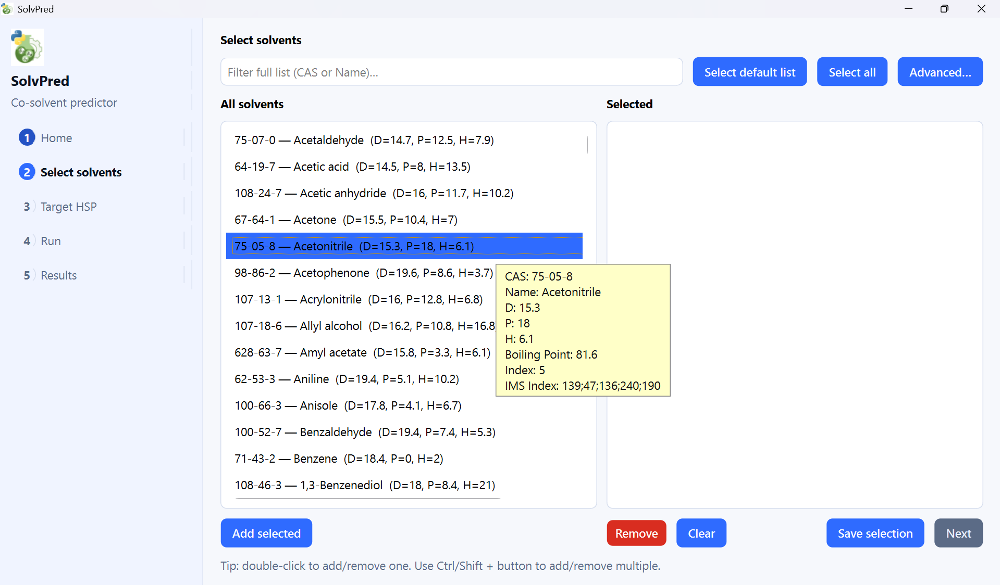

The candidate selection page contains two major panels:

- **All solvents** lists all solvents in the default database.
- **Selected** shows the solvents you have chosen as candidates for calculation.

There are three methods to add solvent candidates.

**Method 1: Load the default list**

Click **Select default list** to load the default solvent database stored in
`SolvPred_App > app > data > default_solv_candidate.json`.

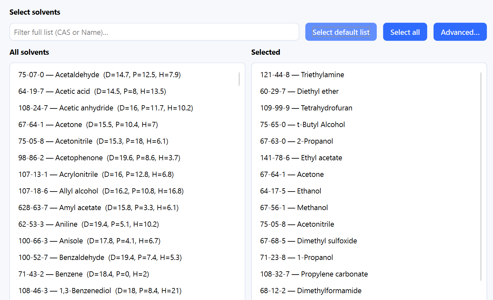

**Method 2: Search and select individually**

Double-click a solvent in the *All solvents* list, or type part of a CAS number or
solvent name in the search box. SolvPred filters the list to show matching entries.

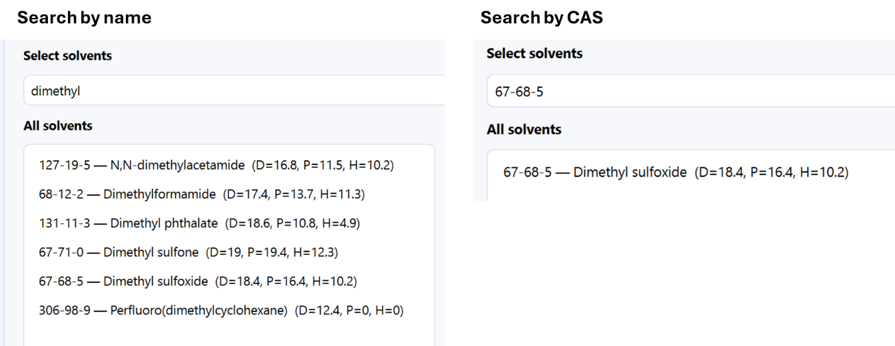

**Method 3: Batch selection**

Select multiple solvents from the *All solvents* list using **Ctrl** or **Shift**, then
click **Add selected** to add them all at once.

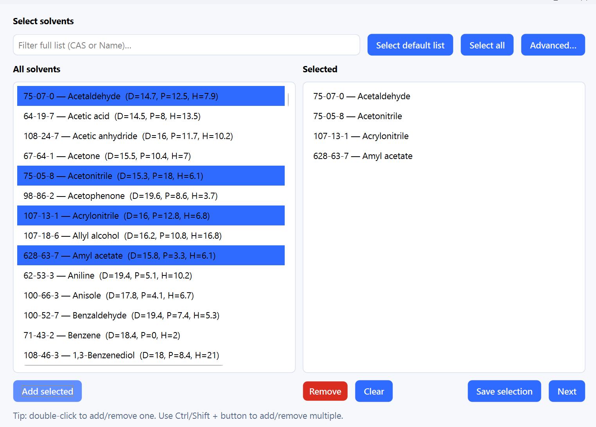

**Viewing solvent details**

Hover the cursor over any solvent to see its full property information, including boiling
point and immiscible solvent indices.

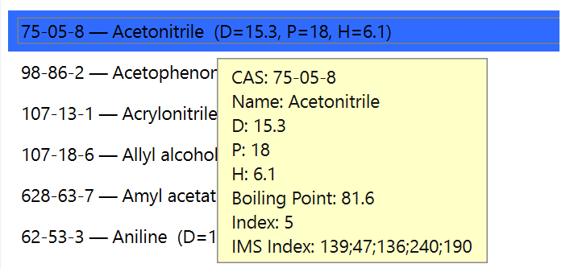

**Removing solvents**

Use the **Remove** button to remove solvents from the *Selected* list.

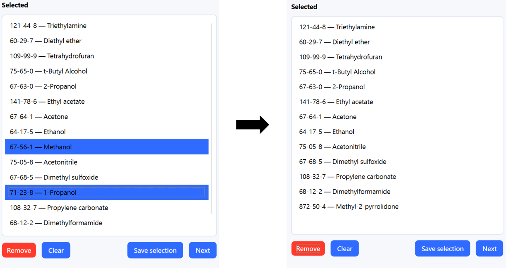

**Saving and loading selections**

Click **Save selection** to save the current *Selected* list as a JSON file for future
reuse. Previously saved selections can be reloaded via
**Advanced > Load solvents from file**.

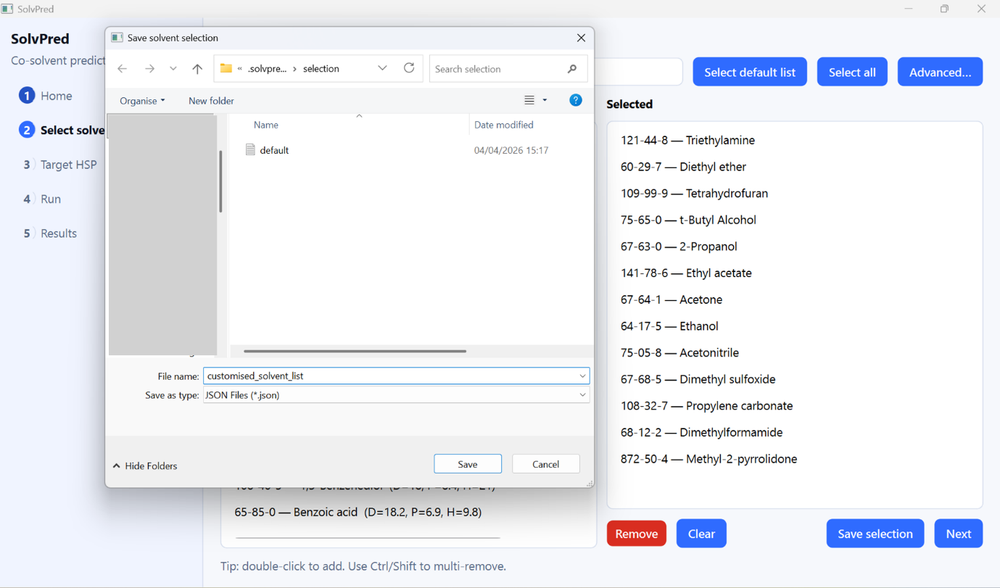

**Advanced candidate options**

The **Advanced** button opens additional options:

- **Add custom solvent** will add solvents not present in the database.
- **Load solvents from file** will reload a previously saved selection.
- **Load user database from file** will load a custom solvent database.
- **Manage user database** can add, edit, or remove solvents from your database.

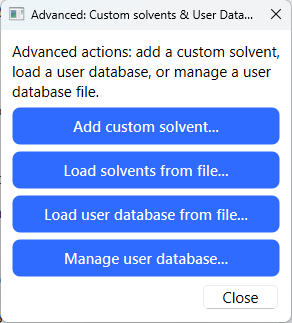

Once the solvent selection step is complete, click **Next** to proceed.

---

### Step 2: Set Target HSP and Parameters

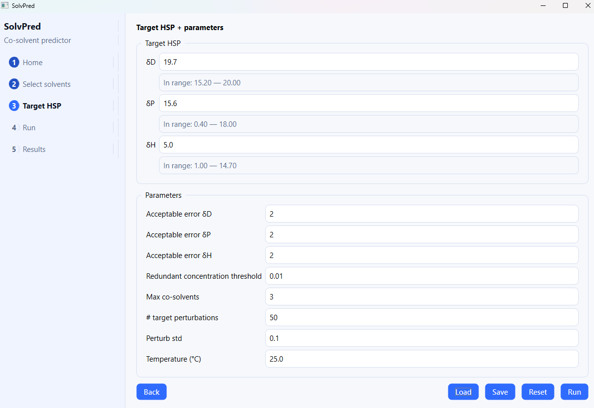

On the **Target HSP** page, set the target HSP values and algorithm hyperparameters:

- **Target HSP** (δD / δP / δH) are the desired solubility parameter values.
- **Acceptable errors** (errD / errP / errH) define how close the calculated HSP must be to
  the target to count as a valid result.
- **Max co-solvents** is the maximum number of co-solvents allowed in the mixture.
- **Temperature** is the operating temperature; SolvPred applies temperature correction
  automatically.

Use **Save** and **Load** to store or restore parameter configurations as JSON files. 
**Reset** restores all defaults. **Back** returns to the candidate selection step.

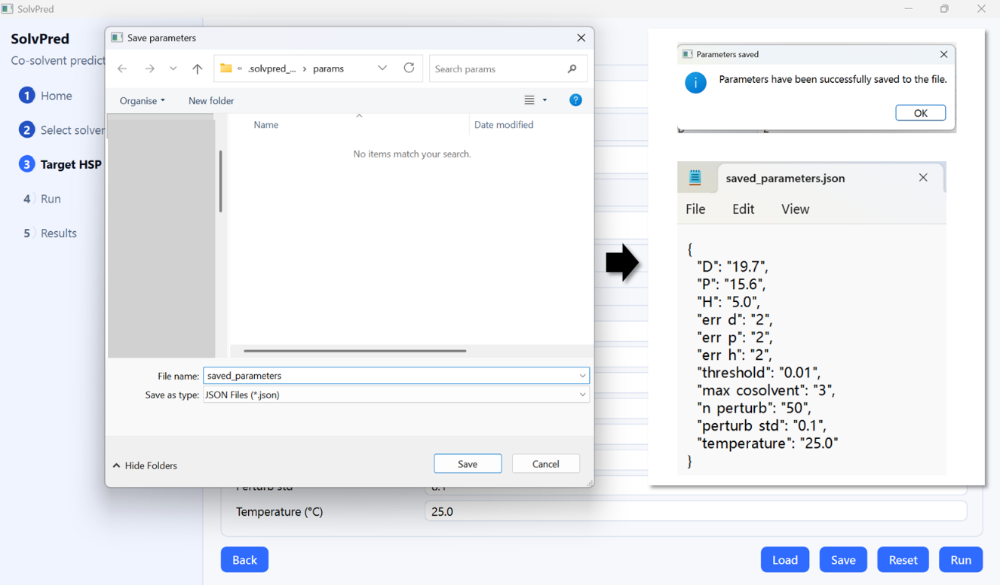

**Achievable HSP range hints**

SolvPred displays the achievable HSP range for each dimension, calculated automatically
from the selected solvents. If a target value falls outside this range, no
valid solution exists. Here, the HSP of any mixture is constrained to the convex polyhedron
formed by the candidate solvents as vertices.

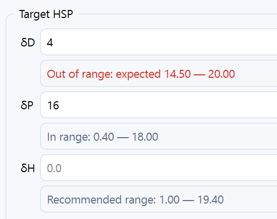

Click **Run** to proceed to the calculation page.

---

### Step 3: Run Calculation

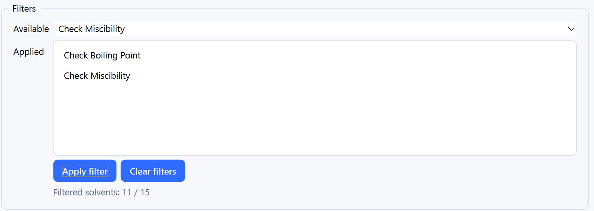

Before running, apply optional pre-calculation filters:

- **Check Boiling Point** will retain only solvents whose boiling point is below the set
  temperature.
- **Check Miscibility** will retain only results where all co-solvents are expected to be
  miscible.

The bottom of the filter panel shows the total number of selected solvents and the count
remaining after filtration. Once satisfied, click **Run**.

---

### Step 4: Review Results

SolvPred displays results as a sortable table on the **Results** page.

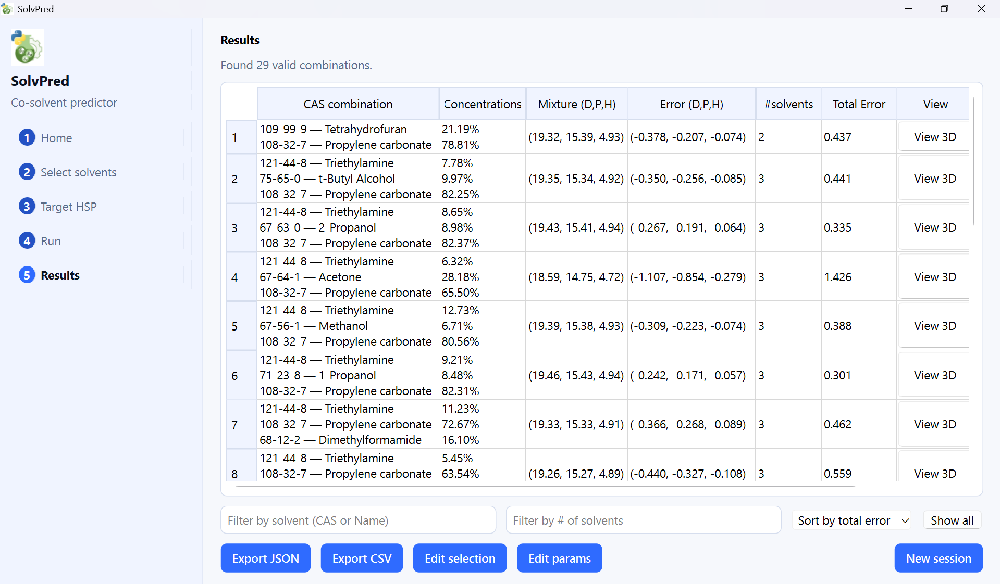

**Filtering and sorting results**

At the bottom of the results table you can:

- Filter by solvent name or CAS number using the **Filter by solvent** box.
- Limit results by the number of co-solvents in each mixture.
- Sort by total HSP error or by the partial error of a specific HSP component.

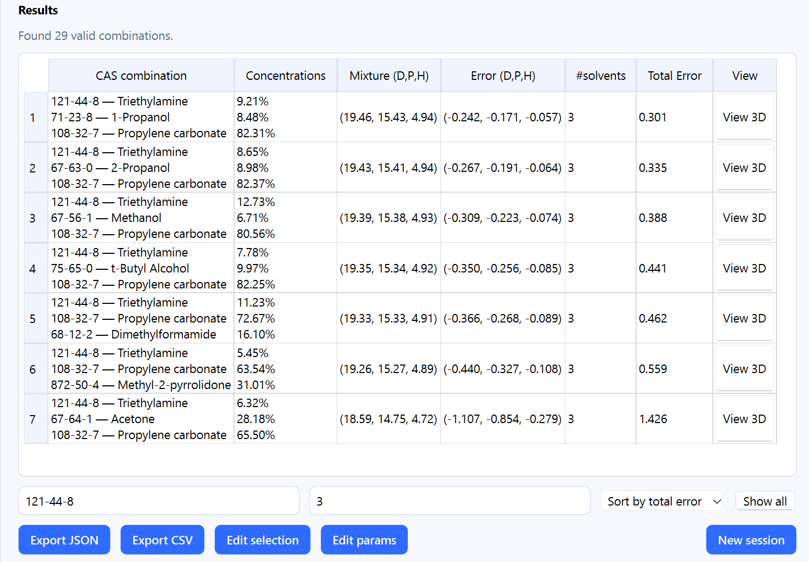

**Viewing solvent details and 3D Hansen space**

Hover over a result entry to see full HSP and property information for each co-solvent.
Click **View 3D** on any entry to open an interactive 3D plot of Hansen space.
Save the plot with **Save PNG**.

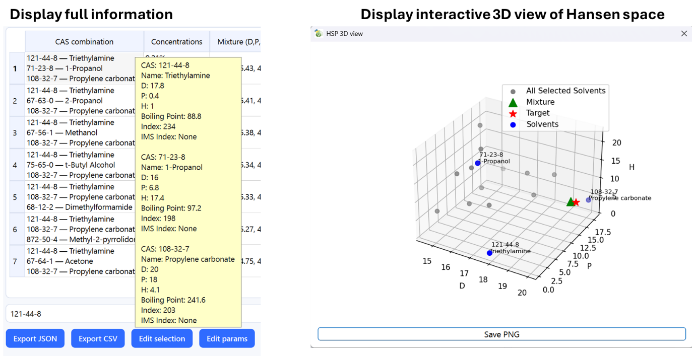

**Exporting results**

Click **Export JSON** or **Export CSV** to save the result table and full metadata.
Files are stored under `SolvPred_App > dist` by default and can be
modified as needed.

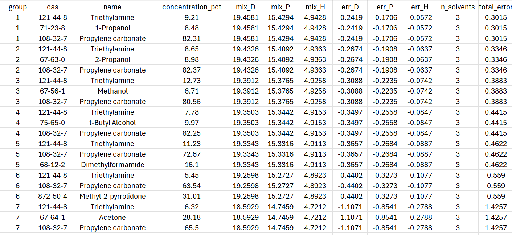

Use **Edit selection** or **Edit params** to return to earlier steps. Click **New session**
to start the entire process fresh.


---

This project is licensed under [GPL-3.0](https://www.gnu.org/licenses/gpl-3.0.html).
